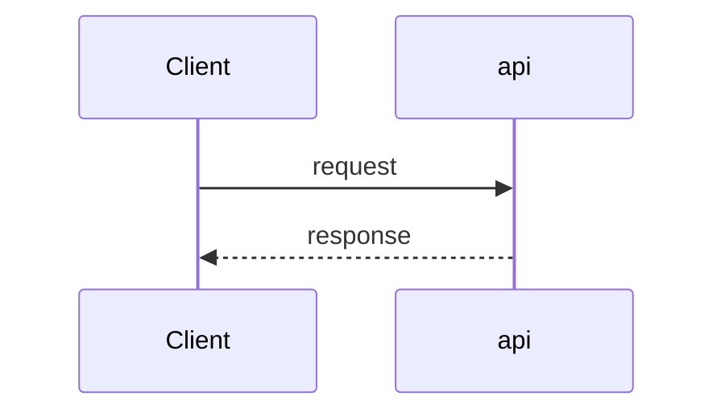

<h2 id="prod">1 Product view</h2>

**What it is.** One sentence on the feature. **User story.** As a [user], I want [capability] so that [value].

| Who | Why it matters |
|---|---|
| User | ... |
| Business | ... |

<h2 id="brd">2 Business requirements (BRD)</h2>

| Item | Detail |
|---|---|
| Objective | ... |
| Success metrics | ... |
| Business rules | ... |
| In scope / Out of scope | ... |
| Stakeholders | ... |

<h2 id="prd">3 Product requirements (PRD)</h2>

**Functional requirements**
1. ...

**Acceptance (given/when/then)** ...
**States & edge cases:** loading, success, error, empty. **Dependencies:** ...

<h2 id="ux">4 UX &amp; UI</h2>

Theme and layout notes.

- Page layout structure: ...

<h2 id="tech">5 Technical implementation</h2>

**APIs** — table of Endpoint | Service | Request to Response.
**Database impact** — tables/columns/migrations.
**Repos & files touched** — which repos and files.
**Implementation plan (ready to build)** — numbered steps.

<h2 id="impl">6 Implementation status</h2>

| Area | Where | Notes |
|---|---|---|
| UI | ... | ... |
| API | ... | ... |

<h2 id="secperf">7 Security &amp; performance</h2>

- Security: ...
- Performance: ...

<h2 id="test">8 Test cases</h2>

**Acceptance criteria** ...

| # | Scenario | Steps | Expected |
|---|---|---|---|
| T1 | Happy path | ... | ... |
